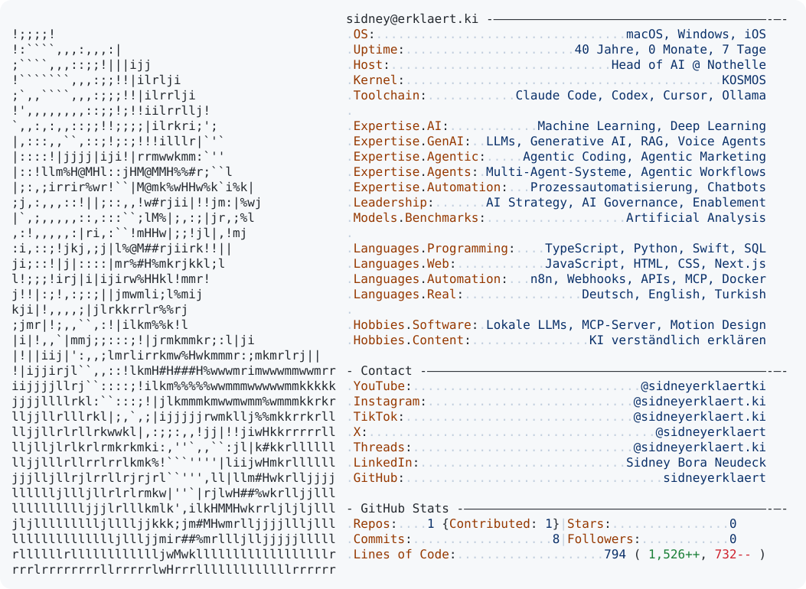

<a href="https://github.com/sidneyerklaert/sidneyerklaert">
  <picture>
    <source media="(prefers-color-scheme: dark)" srcset="https://raw.githubusercontent.com/sidneyerklaert/sidneyerklaert/main/dark_mode.svg">
    <source media="(prefers-color-scheme: light)" srcset="https://raw.githubusercontent.com/sidneyerklaert/sidneyerklaert/main/light_mode.svg">
    
  </picture>
</a>

Design inspiriert von <a href="https://github.com/Andrew6rant/Andrew6rant">Andrew6rant</a>.
